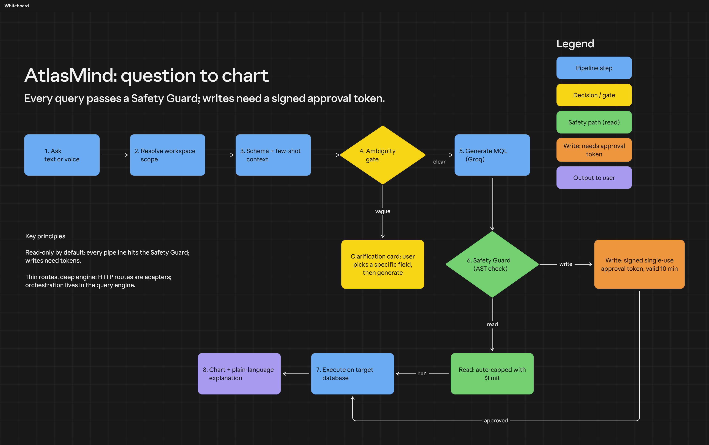
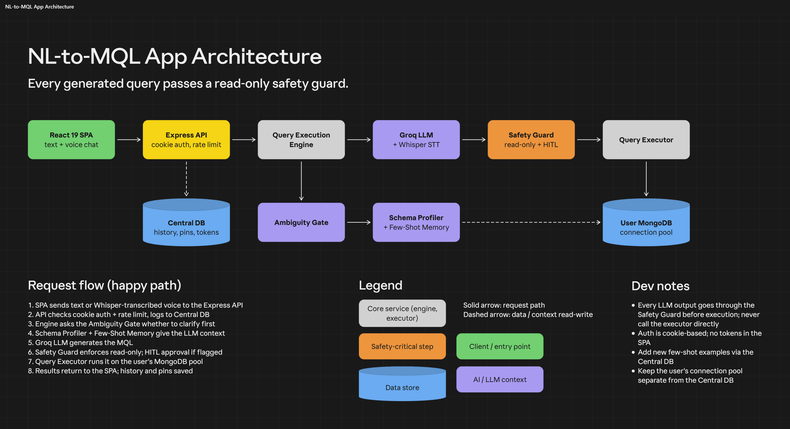
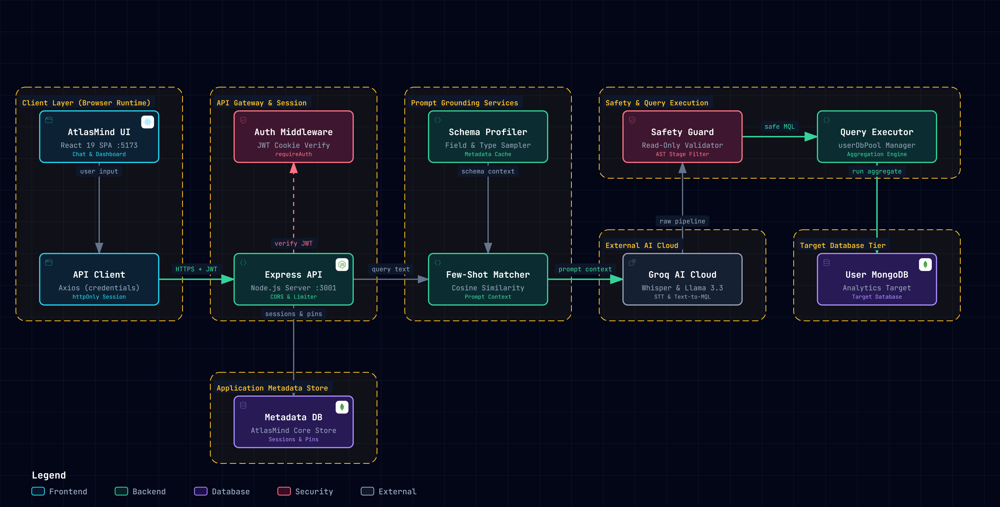

<div align="center">
  <h1>AtlasMind</h1>
  <p><strong>Ask your MongoDB questions in plain English or by voice. Get a safe, read-only query and a chart back.</strong></p>

  <p>
    <a href="https://atlasmind19.netlify.app/"><strong>Live Demo</strong></a> ·
    <a href="./docs/SETUP.md"><strong>Docs</strong></a>
  </p>

  <p>
    
    
    
  </p>

  <p>
    
    
    
    
    
    
    
    
    
    
    
    
    
    
  </p>
</div>

---

## How it works



---

## Architecture



- **Two kinds of database.** The central DB holds app state. Your own databases are reached only through a per-connection pool.
- **Thin routes, deep engine.** Routes are HTTP adapters; all orchestration lives in `services/queryExecutionEngine.js`.
- **Read-only by default.** Every pipeline passes the Safety Guard, and writes need a signed, single-use approval token.

<!--  -->

Full details and sequence diagrams: [docs/ARCHITECTURE.md](./docs/ARCHITECTURE.md)

---

## Quick start

```bash
git clone https://github.com/lakshmanbhukya/AtlasMind.git
cd AtlasMind

# Backend
cd server
npm install
cp .env.example .env   # set MONGODB_URI, GROQ_API_KEY, ENCRYPTION_KEY, JWT_SECRET
npm run dev            # http://localhost:3001

# Frontend (new terminal)
cd client
npm install
npm run dev            # http://localhost:5173
```

More in [docs/SETUP.md](./docs/SETUP.md).

---

## Note

Chat UI design takes inspiration from the clean, minimalist chat interface of Claude Web.
